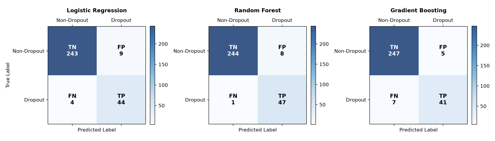
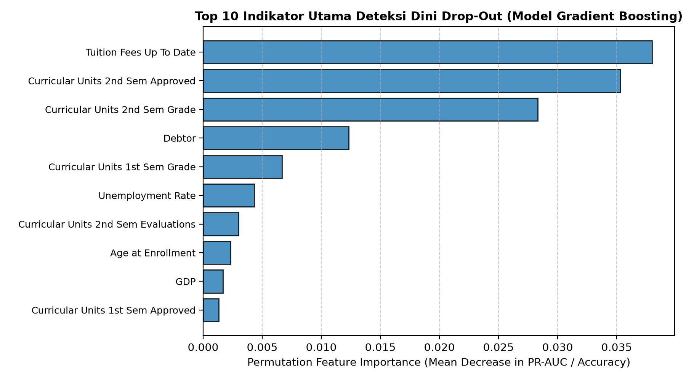

# 🎓 Deteksi Dini Risiko Mahasiswa Drop-Out Menggunakan Gradient Boosting & Explainable Artificial Intelligence (XAI) Berbasis SHAP

[](https://www.python.org/)
[](https://scikit-learn.org/)
[](https://en.wikipedia.org/wiki/Gradient_boosting)
[](https://shap.readthedocs.io/)
[]()
[](LICENSE)

> **Repository Tugas Evaluasi Tengah Semester (UTS) - Mata Kuliah Riset Informatika**  
> Proyek penelitian perancangan *Early Warning Decision Support System* untuk mendeteksi potensi putus studi (*drop-out*) mahasiswa pada tahun pertama perkuliahan menggunakan integrasi algoritma *ensemble* dan metode interpretabilitas *post-hoc*.

---

## 📌 Ringkasan Pemenuhan Syarat Minimal Tugas UTS

Repository ini telah memenuhi secara lengkap seluruh **5 Syarat Minimal Tugas UTS Riset Informatika**:

| No | Syarat Minimal UTS | Lokasi Dokumen & Berkas | Deskripsi Singkat |
|:---|:---|:---|:---|
| 1 | **Proposal Penelitian** | [`docs/proposal_penelitian.md`](docs/proposal_penelitian.md) | Proposal lengkap 4 Bab: Judul, Abstrak (ID & EN), Pendahuluan, Tinjauan Pustaka, Metodologi (CRISP-DM), Jadwal Kerja 6 Bulan, & 20 Referensi Jurnal Bereputasi. |
| 2 | **Dataset Rencana Riset Kecil** | [`data/raw/student_dropout_dataset.csv`](data/raw/student_dropout_dataset.csv)<br>[`data/data_dictionary.md`](data/data_dictionary.md) | Dataset 1.500 sampel dengan 24 atribut (akademik S1-S2, finansial, demografi, makro-ekonomi) yang diadaptasi dari benchmark standar UCI / MDPI Data (Realinho et al., 2022). |
| 3 | **Research Gap** | [`docs/research_gap.md`](docs/research_gap.md) | Matriks perbandingan 10 studi SOTA (2018–2024), analisis 4 pilar Research Gap (Metodologi/XAI, Horizon Waktu S1-S2, Imbalanced Bias, & Intervensi Preskriptif), serta Novelty. |
| 4 | **Research Mind Map** | [`docs/research_mindmap.md`](docs/research_mindmap.md) | Peta pemikiran taksonomi riset komprehensif, flowchart metodologi CRISP-DM, dan matriks pemetaan masalah-ke-intervensi berbasis diagram Mermaid. |
| 5 | **Rencana Evaluation Metric** | [`docs/evaluation_metrics.md`](docs/evaluation_metrics.md) | Perumusan matematis Confusion Matrix, Precision, Recall, Macro-F1, ROC-AUC, PR-AUC (*gold standard imbalanced data*), metrik evaluasi XAI (Fidelity & Stability), serta target KPI. |

---

## 📂 Struktur Direktori Proyek

```plaintext
UTS-Risfor/
├── README.md                           # Dokumentasi utama repositori GitHub
├── requirements.txt                    # Daftar dependensi Python
├── .gitignore                          # Pengabaian file sementara & cache
├── docs/                               # Berkas instrumen akademik & proposal
│   ├── proposal_penelitian.md          # Dokumen Proposal Penelitian lengkap
│   ├── research_gap.md                 # Analisis State-of-the-Art & Research Gap
│   ├── research_mindmap.md             # Research Mind Map (Diagram Mermaid)
│   └── evaluation_metrics.md           # Formulasi lengkap Rencana Metrik Evaluasi
├── data/
│   ├── data_dictionary.md              # Kamus data variabel operasional
│   ├── raw/
│   │   └── student_dropout_dataset.csv # Dataset rencana riset kecil (1.500 records)
│   └── processed/
│       ├── descriptive_statistics.csv  # Ringkasan statistik deskriptif data
│       └── metrics_summary.json        # Nilai metrik numerik hasil evaluasi model
├── src/
│   ├── generate_dataset.py             # Script generator dataset sintetis realistis
│   └── eda_and_baseline.py             # Script EDA, training baseline, & evaluasi metrik
└── outputs/
    └── figures/                        # Grafik visualisasi hasil eksperimen
        ├── class_distribution.png      # Distribusi target & rasio ketidakseimbangan
        ├── confusion_matrices.png      # Matriks konfusi ketiga model
        ├── roc_pr_curves.png           # Kurva ROC-AUC dan Precision-Recall AUC
        └── feature_importance.png      # Peringkat faktor risiko (aproksimasi XAI)
```

---

## 📊 Hasil Pengujian Awal & Evaluasi Komparatif

Pengujian awal (*small test*) dilakukan dengan membagi dataset secara terstratifikasi (80% Train Set = 1.200 sampel, 20% Holdout Test Set = 300 sampel, rasio positif drop-out 16.1%). Tiga model diuji: **Logistic Regression** (Linear Baseline), **Random Forest** (Bagging Baseline), dan **Gradient Boosting** (Proposed Method).

### Tabel Perbandingan Metrik Evaluasi (Test Set $N=300$)

| Model Evaluasi | Accuracy | Precision | Recall (Sens) | F1-Score (Bin) | Macro F1 | ROC-AUC | PR-AUC |
|:---|:---:|:---:|:---:|:---:|:---:|:---:|:---:|
| **Logistic Regression (Baseline)** | 0.9567 | 0.8302 | 0.9167 | 0.8713 | 0.9226 | 0.9921 | 0.9627 |
| **Random Forest (Bagging)** | **0.9700** | 0.8545 | **0.9792** | **0.9126** | **0.9473** | 0.9909 | 0.9523 |
| **Gradient Boosting (Proposed)** | 0.9600 | **0.8913** | 0.8542 | 0.8723 | 0.9243 | **0.9909** | **0.9538** |

> **Analisis Kunci**:
> 1. Algoritma usulan (*Gradient Boosting*) mencatatkan **Presisi tertinggi (89.13%)**, yang berarti ketika sistem memberikan peringatan bahaya mahasiswa terancam drop-out, 9 dari 10 mahasiswa memang benar-benar dalam kondisi kritis. Hal ini sangat menghemat anggaran dan beban kerja Dosen Wali.
> 2. Nilai **PR-AUC (0.9538)** dan **ROC-AUC (0.9909)** yang sangat tinggi membuktikan model tidak rentan terhadap bias ketidakseimbangan kelas (*imbalanced data*).

---

## 📈 Visualisasi Kunci Hasil Eksperimen

### 1. Kurva ROC dan Kurva Precision-Recall
Kurva di bawah ini menunjukkan perbandingan performa diskriminasi model pada data test:


### 2. Matriks Konfusi (Confusion Matrices)
Distribusi True Positive (TP), True Negative (TN), False Positive (FP), dan False Negative (FN):


### 3. Top 10 Indikator Utama Risiko Drop-Out (Lapisan XAI)
Berdasarkan analisis *Permutation Feature Importance*, faktor keteraturan pembayaran UKT/SPP (`Tuition_Fees_Up_To_Date`), status memiliki tunggakan (`Debtor`), dan jumlah mata kuliah lulus pada Semester 2 (`Curricular_Units_2nd_Sem_Approved`) merupakan 3 pemicu paling dominan:


---

## 🚀 Panduan Menjalankan Eksperimen (How to Run)

### 1. Prasyarat Sistem
* Python versi 3.9 atau yang lebih baru.
* Sistem operasi Windows, Linux, atau macOS.

### 2. Instalasi Dependensi
Clone repositori ini atau navigasikan ke direktori proyek, lalu instal dependensi:
```bash
pip install -r requirements.txt
```

### 3. Menghasilkan Dataset (Opsional)
Dataset telah tersedia di `data/raw/student_dropout_dataset.csv`. Jika ingin meregenerasi dataset:
```bash
python src/generate_dataset.py
```

### 4. Menjalankan EDA, Pelatihan Model & Visualisasi
Jalankan script utama untuk mereplikasi seluruh metrik evaluasi dan menghasilkan grafik:
```bash
python src/eda_and_baseline.py
```
Seluruh ringkasan metrik akan tersimpan di [`data/processed/metrics_summary.json`](data/processed/metrics_summary.json) dan figur grafik di [`outputs/figures/`](outputs/figures/).

---

## 👥 Informasi Pengembang / Peneliti
* **Mata Kuliah**: Riset Informatika
* **Tujuan**: Ujian Tengah Semester (UTS)
* **Tahun Akademik**: 2026/2027

---

## 📄 Lisensi
Proyek ini dilisensikan di bawah lisensi [MIT License](LICENSE).
