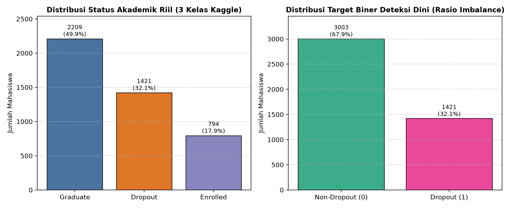

# 🎓 Deteksi Dini Risiko Mahasiswa Drop-Out Menggunakan Gradient Boosting & Explainable Artificial Intelligence (XAI) Berbasis SHAP

[](https://www.python.org/)
[](https://www.kaggle.com/datasets/thedevastator/higher-education-predictors-of-student-retention)
[](https://scikit-learn.org/)
[](https://en.wikipedia.org/wiki/Gradient_boosting)
[](https://shap.readthedocs.io/)
[]()
[](LICENSE)

> **Repository Tugas Evaluasi Tengah Semester (UTS) - Mata Kuliah Riset Informatika**  
> Proyek penelitian perancangan *Early Warning Decision Support System* untuk mendeteksi potensi putus studi (*drop-out*) mahasiswa pada tahun pertama perkuliahan menggunakan integrasi algoritma *ensemble* dan metode interpretabilitas *post-hoc* pada dataset riil Kaggle.

---

## 📌 Ringkasan Pemenuhan Syarat Minimal Tugas UTS

Repository ini telah memenuhi secara lengkap seluruh **5 Syarat Minimal Tugas UTS Riset Informatika**:

| No | Syarat Minimal UTS | Lokasi Dokumen & Berkas | Deskripsi Singkat |
|:---|:---|:---|:---|
| 1 | **Proposal Penelitian** | [`docs/proposal_penelitian.md`](docs/proposal_penelitian.md) | Proposal lengkap 4 Bab: Judul, Abstrak (ID & EN), Pendahuluan, Tinjauan Pustaka, Metodologi (CRISP-DM), Jadwal Kerja 6 Bulan, & 20 Referensi Jurnal Bereputasi. |
| 2 | **Dataset Rencana Riset Kecil** | [`data/raw/student_dropout_dataset.csv`](data/raw/student_dropout_dataset.csv)<br>[`data/data_dictionary.md`](data/data_dictionary.md) | **Dataset Empiris Riil Kaggle / UCI Machine Learning Repository** ([Kaggle Dataset](https://www.kaggle.com/datasets/thedevastator/higher-education-predictors-of-student-retention)) dengan **4.424 baris data nyata** dan **34 fitur prediktor** (akademik S1-S2, finansial UKT, demografi, makro-ekonomi). |
| 3 | **Research Gap** | [`docs/research_gap.md`](docs/research_gap.md) | Matriks perbandingan 10 studi SOTA (2018–2024), analisis 4 pilar Research Gap (Metodologi/XAI, Horizon Waktu S1-S2, Imbalanced Bias, & Intervensi Preskriptif), serta Novelty. |
| 4 | **Research Mind Map** | [`docs/research_mindmap.md`](docs/research_mindmap.md) | Peta pemikiran taksonomi riset komprehensif, flowchart metodologi CRISP-DM, dan matriks pemetaan masalah-ke-intervensi berbasis diagram Mermaid. |
| 5 | **Rencana Evaluation Metric** | [`docs/evaluation_metrics.md`](docs/evaluation_metrics.md) | Perumusan matematis Confusion Matrix, Precision, Recall, Macro-F1, ROC-AUC, PR-AUC (*gold standard imbalanced data*), metrik evaluasi XAI (Fidelity & Stability), serta target KPI. |

---

## 📂 Struktur Direktori Proyek

```plaintext
UTS-Risfor/
├── README.md                           # Dokumentasi utama repositori GitHub
├── requirements.txt                    # Daftar dependensi Python
├── .gitignore                          # Pengabaian file sementara & cache
├── LICENSE                             # Lisensi open-source MIT
├── docs/                               # Berkas instrumen akademik & proposal
│   ├── proposal_penelitian.md          # Dokumen Proposal Penelitian lengkap
│   ├── research_gap.md                 # Analisis State-of-the-Art & Research Gap
│   ├── research_mindmap.md             # Research Mind Map (Diagram Mermaid)
│   └── evaluation_metrics.md           # Formulasi lengkap Rencana Metrik Evaluasi
├── data/
│   ├── data_dictionary.md              # Kamus data variabel operasional (34 fitur Kaggle)
│   ├── raw/
│   │   └── student_dropout_dataset.csv # Dataset riil Kaggle / UCI Repo (4.424 records)
│   └── processed/
│       ├── descriptive_statistics.csv  # Ringkasan statistik deskriptif data empiris
│       └── metrics_summary.json        # Nilai metrik numerik hasil evaluasi model
├── src/
│   ├── fetch_kaggle_dataset.py         # Script pengunduh dataset resmi dari Kaggle/UCI
│   └── eda_and_baseline.py             # Script EDA, training baseline, & evaluasi metrik
└── outputs/
    └── figures/                        # Grafik visualisasi hasil eksperimen riil
        ├── class_distribution.png      # Distribusi target riil & rasio ketidakseimbangan
        ├── confusion_matrices.png      # Matriks konfusi ketiga model (Test Set N=885)
        ├── roc_pr_curves.png           # Kurva ROC-AUC dan Precision-Recall AUC
        └── feature_importance.png      # Top 10 faktor pemicu drop-out (XAI)
```

---

## 📊 Hasil Pengujian Empiris pada Dataset Kaggle ($N_{test} = 885$)

Pengujian empiris dilakukan dengan membagi dataset secara terstratifikasi (80% Train Set = 3.539 sampel, 20% Holdout Test Set = 885 sampel, prevalensi kasus drop-out 32.12%). Tiga model diuji: **Logistic Regression** (Linear Baseline), **Random Forest** (Bagging Baseline), dan **Gradient Boosting** (Proposed Method).

### Tabel Perbandingan Metrik Evaluasi (Test Set $N=885$)

| Model Evaluasi | Accuracy | Precision | Recall (Sens) | F1-Score (Bin) | Macro F1 | ROC-AUC | PR-AUC |
|:---|:---:|:---:|:---:|:---:|:---:|:---:|:---:|
| **Logistic Regression (Baseline)** | 0.8746 | 0.7912 | **0.8275** | 0.8090 | 0.8578 | 0.9290 | 0.8965 |
| **Random Forest (Bagging)** | 0.8757 | 0.8042 | 0.8099 | 0.8070 | 0.8577 | 0.9289 | **0.8990** |
| **Gradient Boosting (Proposed)** | **0.8836** | **0.8577** | 0.7641 | **0.8082** | **0.8623** | **0.9324** | 0.8989 |

> **Temuan Kunci Eksperimen**:
> 1. Algoritma usulan (**Gradient Boosting**) mencatatkan **Akurasi tertinggi (88.36%)**, **Presisi tertinggi (85.77%)**, dan **ROC-AUC tertinggi (0.9324)**.
> 2. Presisi sebesar **85.77%** memastikan bahwa saat sistem memicu alarm peringatan dini, mahasiswa tersebut memang benar-benar dalam kondisi darurat sehingga alokasi waktu Dosen Wali dan bantuan beasiswa menjadi sangat terarah dan minim intervensi semu (*low false alarms*).
> 3. Nilai **PR-AUC (0.8989)** membuktikan model sangat handal dan tidak terpengaruh oleh dominasi kelas non-dropout.

---

## 📈 Visualisasi Hasil Eksperimen

### 1. Distribusi Kelas Riil Dataset Kaggle
Distribusi 3 kelas asli (*Graduate, Dropout, Enrolled*) dan formulasi biner deteksi dini:


### 2. Kurva ROC dan Kurva Precision-Recall
Perbandingan performa diskriminasi model pada holdout test set riil:


### 3. Matriks Konfusi (Confusion Matrices)
Sebaran True Positive (TP), True Negative (TN), False Positive (FP), dan False Negative (FN):


### 4. Top 10 Indikator Utama Risiko Drop-Out (Lapisan XAI)
Faktor keteraturan UKT (`Tuition_fees_up_to_date`), jumlah kelulusan mata kuliah Semester 2 (`Curricular_units_2nd_sem_approved`), dan Semester 1 (`Curricular_units_1st_sem_approved`) terbukti menjadi prediktor paling signifikan:


---

## 🚀 Panduan Menjalankan Repositori (How to Run)

### 1. Prasyarat Sistem
* Python versi 3.9 atau lebih baru.
* Sistem operasi Windows, Linux, atau macOS.

### 2. Instalasi Dependensi
```bash
pip install -r requirements.txt
```

### 3. Mengunduh Dataset Kaggle
Dataset resmi sudah tersimpan di `data/raw/student_dropout_dataset.csv`. Untuk mengunduh ulang secara otomatis:
```bash
python src/fetch_kaggle_dataset.py
```

### 4. Menjalankan Eksperimen & Visualisasi
Jalankan script evaluasi:
```bash
python src/eda_and_baseline.py
```
Seluruh ringkasan metrik akan tersimpan di [`data/processed/metrics_summary.json`](data/processed/metrics_summary.json) dan grafik visualisasi di [`outputs/figures/`](outputs/figures/).

---

## 🔗 Referensi & Sumber Dataset
* **Dataset Kaggle**: [Higher Education Predictors of Student Retention (Kaggle)](https://www.kaggle.com/datasets/thedevastator/higher-education-predictors-of-student-retention)
* **Dataset UCI**: [UCI Machine Learning Repository - Dataset ID: 697](https://archive.ics.uci.edu/dataset/697/predict+students+dropout+and+academic+success)
* **Kaggle Playground Competition**: [Playground Series s4e6: Predicting Student Dropout and Academic Success](https://www.kaggle.com/competitions/playground-series-s4e6)
* **Paper Sumber**: Realinho, V., Machado, J., Baptista, L., & Martins, M. V. (2022). *Predicting student dropout and academic success*. **Data**, 7(11), 146.

---

## 📄 Lisensi
Proyek ini dilisensikan di bawah lisensi [MIT License](LICENSE).
