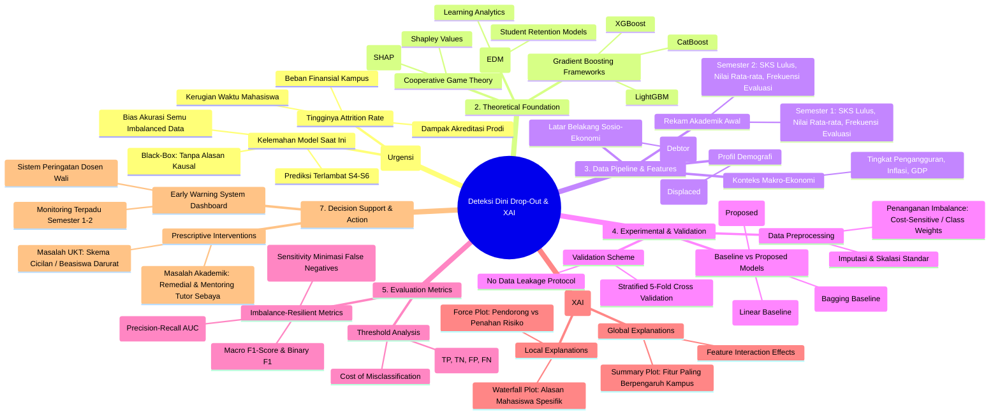

# 🧠 04 - Research Mind Map
## Peta Pemikiran Riset & Alur Metodologi Penelitian

Folder ini memuat visualisasi peta pemikiran komprehensif, diagram alur metodologi (*workflow*), serta matriks pemetaan masalah-metrik-intervensi berbasis diagram **Mermaid**.

---

### 📄 Berkas Utama
* **Dokumen Lengkap**: [`research_mindmap.md`](research_mindmap.md)

---

### 🗺️ Peta Pemikiran Riset Utama (*Research Mind Map*)



---

### 🔄 Diagram Alur Kerja Riset (*End-to-End Workflow*)

```mermaid
flowchart TD
    classDef startend fill:#1b9e77,stroke:#000,stroke-width:1.5px,color:#fff;
    classDef step fill:#f0f4f8,stroke:#2b5c8f,stroke-width:1.5px,color:#111;
    classDef decision fill:#fff2cc,stroke:#d6b656,stroke-width:1.5px,color:#000;
    classDef xai fill:#e1d5e7,stroke:#9673a6,stroke-width:1.5px,color:#000;
    classDef output fill:#d5e8d4,stroke:#82b366,stroke-width:1.5px,color:#000;

    Start([Mulai: Identifikasi Masalah Drop-Out]) :::startend --> DataPrep[Pengumpulan Data Kaggle/UCI:<br>4.424 Rekam Mahasiswa] :::step
    DataPrep --> Preprocessing[Data Preprocessing:<br>Pembersihan, Verifikasi, Standarisasi] :::step
    Preprocessing --> Split[Stratified Splitting:<br>80% Train / 20% Test] :::step
    
    Split --> TrainBaseline[Latih Baseline:<br>Logistic Regression & Random Forest] :::step
    Split --> TrainGB[Latih Model Usulan:<br>Gradient Boosting dengan Class Weights] :::step
    
    TrainBaseline --> EvalComp[Evaluasi Komparasi Model:<br>PR-AUC, ROC-AUC, Recall, Precision, Macro-F1] :::decision
    TrainGB --> EvalComp
    
    EvalComp --> XAILayer[Lapisan Explainable AI: SHAP Explainer Engine] :::xai
    XAILayer --> GlobalSHAP[Analisis Global: Fitur Risiko Kampus] :::xai
    XAILayer --> LocalSHAP[Analisis Lokal: Waterfall Plot Per Mahasiswa] :::xai
    
    GlobalSHAP --> Prescriptive[Pemetaan Intervensi Preskriptif:<br>Kategori Finansial vs Kategori Akademik] :::output
    LocalSHAP --> Prescriptive
    Prescriptive --> Deployment([Integrasi Early Warning Dashboard Dosen Wali]) :::startend
```
