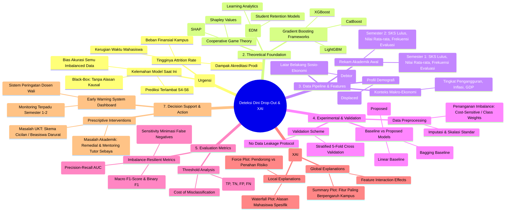

# 🧠 Research Mind Map
## Riset: Deteksi Dini Risiko Mahasiswa Drop-Out Menggunakan Gradient Boosting & Explainable AI (XAI) Berbasis SHAP

Dokumen ini menyajikan peta pemikiran (*mind map*) dan alur arsitektur penelitian yang memetakan keterkaitan antara masalah riil di perguruan tinggi, fondasi teori, metodologi eksperimental, lapisan interpretabilitas (XAI), hingga keluaran aksi preskriptif.

---

## 1. Peta Pikiran Riset Utama (*Comprehensive Research Mind Map*)

Diagram berikut menggambarkan struktur taksonomi riset secara menyeluruh dari hulu (masalah) ke hilir (intervensi).



---

## 2. Diagram Alur Kerja Riset (*End-to-End Research Workflow*)

Diagram alir berikut merinci langkah-langkah metodologis berbasis kerangka kerja CRISP-DM yang diadaptasi:

```mermaid
flowchart TD
    classDef startend fill:#1b9e77,stroke:#000,stroke-width:1.5px,color:#fff;
    classDef step fill:#f0f4f8,stroke:#2b5c8f,stroke-width:1.5px,color:#111;
    classDef decision fill:#fff2cc,stroke:#d6b656,stroke-width:1.5px,color:#000;
    classDef xai fill:#e1d5e7,stroke:#9673a6,stroke-width:1.5px,color:#000;
    classDef output fill:#d5e8d4,stroke:#82b366,stroke-width:1.5px,color:#000;

    Start([Mulai: Identifikasi Masalah Drop-Out]) :::startend --> DataPrep[Pengumpulan Data Primer/Sekunder:<br>Rekam Akademik Semester 1-2 & Finansial] :::step
    
    DataPrep --> Preprocessing[Data Preprocessing:<br>Pembersihan Outlier, Validasi Missing Values, Scaling] :::step
    Preprocessing --> Split[Stratified 5-Fold Splitting:<br>80% Train Set / 20% Holdout Test Set] :::step
    
    Split --> TrainBaseline[Latih Model Baseline:<br>Logistic Regression & Random Forest] :::step
    Split --> TrainGB[Latih Model Usulan:<br>Gradient Boosting / XGBoost dengan Class Weights] :::step
    
    TrainBaseline --> EvalComp[Evaluasi Komparasi Model:<br>Akurasi, Recall, Precision, PR-AUC, ROC-AUC] :::decision
    TrainGB --> EvalComp
    
    EvalComp --> ValidateReq{Memenuhi Target KPI?<br>PR-AUC > 0.85 & Recall > 0.80} :::decision
    ValidateReq -- Tidak --> Tune[Hyperparameter Tuning via Optuna / GridSearch] :::step
    Tune --> TrainGB
    
    ValidateReq -- Ya --> XAILayer[Lapisan Explainable AI: SHAP Explainer Engine] :::xai
    
    XAILayer --> GlobalSHAP[Analisis Global:<br>Top Fitur Risiko Seluruh Kampus] :::xai
    XAILayer --> LocalSHAP[Analisis Lokal Per Mahasiswa:<br>Waterfall Plot & Pemetaan Akar Masalah] :::xai
    
    GlobalSHAP --> Prescriptive[Pemetaan Intervensi Preskriptif:<br>Kategori Finansial vs Kategori Akademik] :::output
    LocalSHAP --> Prescriptive
    
    Prescriptive --> Deployment([Integrasi Early Warning Dashboard Dosen Wali]) :::startend
```

---

## 3. Matriks Pemetaan Masalah, Metrik, dan Intervensi (*Problem-Solution Mapping*)

| Dimensi Masalah | Indikator Kunci (Fitur Data) | Respon Model Prediktif | Lapisan XAI (SHAP Attribution) | Rekomendasi Aksi Preskriptif |
| :--- | :--- | :--- | :--- | :--- |
| **Finansial & Administratif** | `Tuition_Fees_Up_To_Date`<br>`Debtor`<br>`Scholarship_Holder` | Peningkatan tajam log-odds risiko jika SPP macet | Fitur finansial menyumbang kontribusi positif terbesar ke arah drop-out | Rekomendasi restrukturisasi cicilan UKT, bantuan beasiswa ikatan dinas, atau *emergency financial aid*. |
| **Kapasitas Akademik Awal** | `Curricular_Units_1st_Sem_Approved`<br>`Curricular_Units_1st_Sem_Grade` | Kegagalan $\ge$ 2 mata kuliah S1 menurunkan drastis probabilitas retensi | Kontribusi negatif dari rendahnya mata kuliah lulus | Pemanggilan oleh Dosen PA, penugasan asisten tutor sebaya, dan pembatasan SKS Semester 2. |
| **Adaptasi & Sosio-Demografi** | `Displaced` (Merantau)<br>`Age_at_Enrollment`<br>`Gender` | Usia masuk lebih dewasa memiliki sensitivitas waktu lebih tinggi | Kontribusi tambahan pada kelompok usia kerja / mahasiswa perantau | Program bimbingan konseling adaptasi kampus dan *flexible learning schedule* bagi mahasiswa pekerja. |

---

## 4. Keuntungan Arsitektur Riset yang Diusulkan
1. **Transparansi Menyeluruh (*End-to-End Transparency*)**: Tidak ada keputusan prediksi yang diambil tanpa atribusi nilai kontribusi SHAP.
2. **Berorientasi Tindakan (*Action-Driven*)**: Menghilangkan jurang pemisah antara data scientist kampus dan dosen pembimbing akademik di lapangan.
3. **Ketahanan Terhadap Data Tidak Seimbang (*Imbalance-Robust*)**: Penggunaan metrik PR-AUC memastikan performa model tidak tertipu oleh kelas mayoritas.
