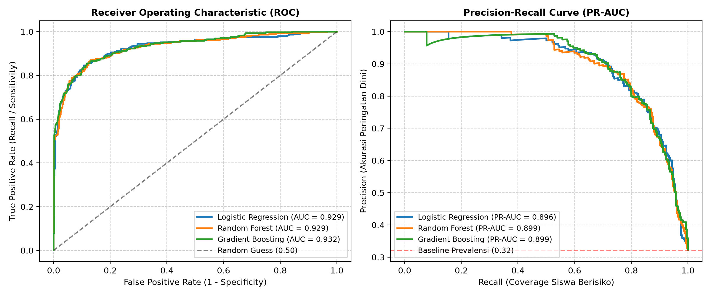
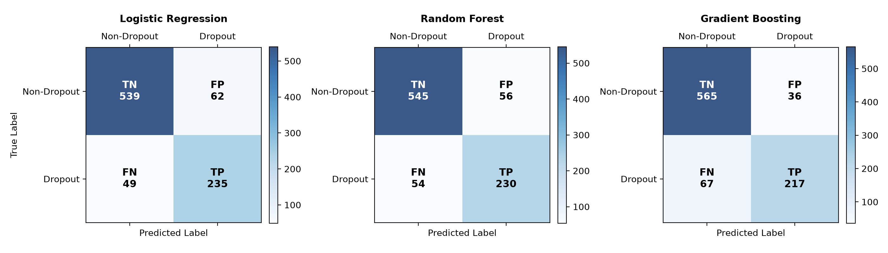
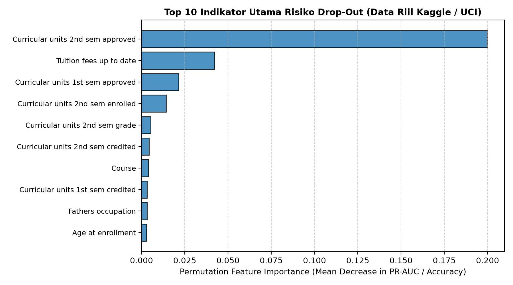

# 📊 05 - Evaluation Metric & Hasil Eksperimen
## Formulasi Metrik Evaluasi, Protokol Validasi, dan Hasil Uji Empiris

Folder ini memuat dokumen rencana evaluasi metrik matematis, script eksekusi evaluasi, ringkasan nilai metrik dalam format JSON, serta visualisasi grafik eksperimen pada dataset riil Kaggle ($N=4.424$).

---

### 📂 Berkas di Folder Ini
* **`evaluation_metrics.md`**: Dokumen formulasi matematis, analisis paradoks akurasi, dan metrik XAI.
* **`eda_and_baseline.py`**: Script Python untuk melatih model dan menghitung seluruh metrik secara otomatis.
* **`metrics_summary.json`**: Hasil numerik lengkap seluruh metrik evaluasi dalam format JSON.
* **`figures/`**: Direktori grafik visualisasi hasil eksperimen:
  * `class_distribution.png`: Distribusi target dataset riil Kaggle.
  * `confusion_matrices.png`: Matriks konfusi perbandingan ketiga model.
  * `roc_pr_curves.png`: Kurva ROC-AUC dan Precision-Recall AUC.
  * `feature_importance.png`: Top 10 prediktor utama risiko drop-out.

---

### 📊 Tabel Hasil Pengujian Empiris (Holdout Test Set $N = 885$)

| Model Evaluasi | Accuracy | Precision | Recall (Sens) | F1-Score (Bin) | Macro F1 | ROC-AUC | PR-AUC |
|:---|:---:|:---:|:---:|:---:|:---:|:---:|:---:|
| **Logistic Regression (Baseline)** | 0.8746 | 0.7912 | **0.8275** | 0.8090 | 0.8578 | 0.9290 | 0.8965 |
| **Random Forest (Bagging)** | 0.8757 | 0.8042 | 0.8099 | 0.8070 | 0.8577 | 0.9289 | **0.8990** |
| **Gradient Boosting (Proposed)** | **0.8836** | **0.8577** | 0.7641 | **0.8082** | **0.8623** | **0.9324** | 0.8989 |

---

### 📈 Visualisasi Hasil Eksperimen

#### 1. Kurva ROC-AUC dan Precision-Recall AUC


#### 2. Matriks Konfusi (Confusion Matrix)


#### 3. Top 10 Indikator Utama Drop-Out (Lapisan XAI)


---

### 🔄 Cara Menjalankan Evaluasi
Jalankan script Python:
```bash
python eda_and_baseline.py
```
Seluruh metrik akan otomatis dihitung ulang dan disimpan ke `metrics_summary.json` dan `figures/`.
